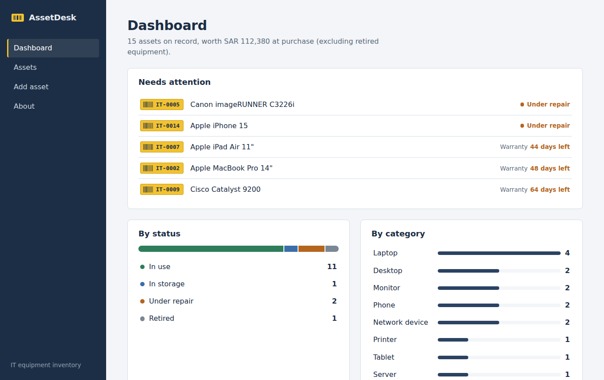

# AssetDesk: IT equipment inventory

AssetDesk is a React web app for managing a company's IT equipment: laptops, desktops, monitors, printers, phones, tablets, servers and network devices. It records who each device is assigned to, where it is, what it cost and when its warranty ends.

This is the SE411 project (Fall 2026–27):

- **Part 1:** the React frontend.
- **Part 2:** a **Java Spring server** (`backend/`) that stores the assets in an H2 database and exposes a REST API. The React app now reads and writes all its data through that API.



## Team

| Name | Student ID |
|---|---|
| Omar Moustafa Aleraky | 223211469 |
| Khaled Samer Abdou | 223110669 |
| Ahmed Sabbah Quraiba | 220110509 |
| Meshal Alaqil | 222111251 |

## Features

- **Dashboard:** total assets and value, items that need attention (under repair or warranty ending within 90 days), and breakdowns by status and category that link to filtered lists.
- **Display:** a sortable table of all assets, **paginated by the server** (10 per page), plus a details page for each one.
- **Search by id:** a "Find by ID" box opens an asset by its database id (`GET /api/v1/assets/{id}`).
- **Search:** free-text search across tag, brand, model, serial number, person, department, location and category, combined with category and status filters.
- **Add:** a validated form that suggests the next free asset tag.
- **Update:** the same form, pre-filled, for editing an existing asset.
- **Delete:** with a confirmation dialog, from the list or the details page.
- **Menu** to move between Dashboard, Assets, Add asset and About.
- **About page** listing the team members and their student IDs.

Full details are in [docs/FEATURES.md](docs/FEATURES.md).

## Getting started

You need **Java 21** and **Node.js 20 or newer**. Start the server first, then the frontend, each in its own terminal.

**1. Spring server** (http://localhost:3001):

```bash
cd backend
./mvnw spring-boot:run        # on Windows: mvnw.cmd spring-boot:run
```

**2. React app** (http://localhost:5173):

```bash
npm install      # first time only
npm run dev
```

The database is in memory, so restarting the server resets it to the 15 sample assets. To point the frontend at a different server, set `VITE_API_URL` (default `http://localhost:3001/api/v1/assets`).

### Tests

```bash
cd backend && ./mvnw test     # backend: JUnit 5 + Mockito (42 tests)
npm test                      # frontend: Vitest (67 tests)
```

Other frontend commands:

```bash
npm run test:coverage  # run tests with a coverage report
npm run build          # production build into dist/
npm run preview        # serve the production build
```

## Tech stack

- **Backend:** Java 21 · Spring Boot 4.1.2 (Web MVC, Data JDBC, Validation) · H2 · JUnit 5 · Mockito · Maven.
- **Frontend:** React 18 · React Router 7 · Vite 8 · Vitest 5 · React Testing Library · plain CSS.

See [docs/ARCHITECTURE.md](docs/ARCHITECTURE.md).

## REST API

| Method | Route | Description | Success | Errors |
|---|---|---|---|---|
| GET | `/api/v1/assets?page=0&size=10&sort=assetTag&dir=asc` | All assets, paginated | 200 | 400 |
| GET | `/api/v1/assets/{id}` | One asset by id | 200 | 404, 400 |
| POST | `/api/v1/assets` | Add an asset | 201 + `Location` | 400, 409 |
| PUT | `/api/v1/assets/{id}` | Update an asset | 204 | 400, 404, 409 |
| DELETE | `/api/v1/assets/{id}` | Delete an asset | 204 | 404 |

Full details are in [docs/API.md](docs/API.md).

## Project structure

```
backend/                Spring server (Maven project)
  src/main/java/edu/psu/se411/assetdesk/
    controller/         AssetController (REST routes)
    service/            AssetService (business logic)
    repository/         AssetRepository (Spring Data JDBC)
    model/              Asset record
    exception/          ObjectNotFoundException, DuplicateAssetException
  src/main/resources/   application.properties, schema.sql, data.sql
  src/test/java/...     service tests (Mockito), controller tests (MockMvc), integration tests
src/
  api/                  assetApi.js: fetch calls to the Spring server
  App.jsx               routes + providers
  main.jsx              entry point (BrowserRouter)
  styles.css            all styling and design tokens
  components/           reusable UI (Layout, AssetForm, AssetTag, badges, dialogs)
  context/              AssetContext (data loaded from the API + CRUD), ToastContext (messages)
  data/                 option lists, team members
  pages/                one component per screen
  utils/                pure logic: validation, search/sort, formatting
  test/                 UI tests, in-memory fake API, sample data
docs/                   requirements, design, architecture, features, tests, code review, AI usage
```

## Documentation

| Document | Contents |
|---|---|
| [Requirements](docs/REQUIREMENTS.md) | Functional and non-functional requirements, data model, user stories |
| [Visual design](docs/DESIGN.md) | Design tokens, typography, layout, screens, accessibility |
| [Architecture](docs/ARCHITECTURE.md) | Overall architecture, tech stack, backend layers, data flow |
| [REST API](docs/API.md) | Routes, request/response formats, status codes, validation rules |
| [Features](docs/FEATURES.md) | What each screen does and how to use it |
| [Test report](docs/TEST_REPORT.md) | Test strategy, test list, results and coverage |
| [Code review](docs/CODE_REVIEW.md) | Security, performance, quality and reuse review, with fixes |
| [AI usage](docs/AI_USAGE.md) | How the AI tool was used in this part |

## Notes

- The H2 database lives in memory: data survives page reloads but is reset when the Spring server restarts.
- Sample people and serial numbers are fictional.
