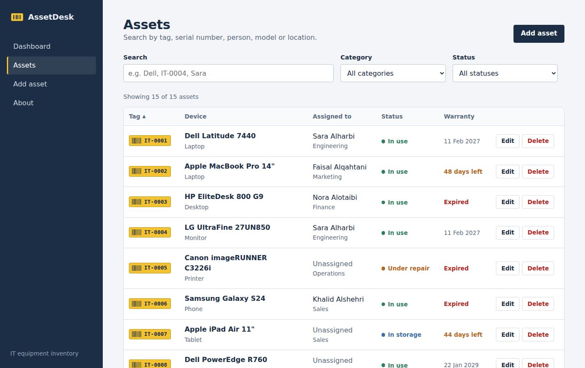
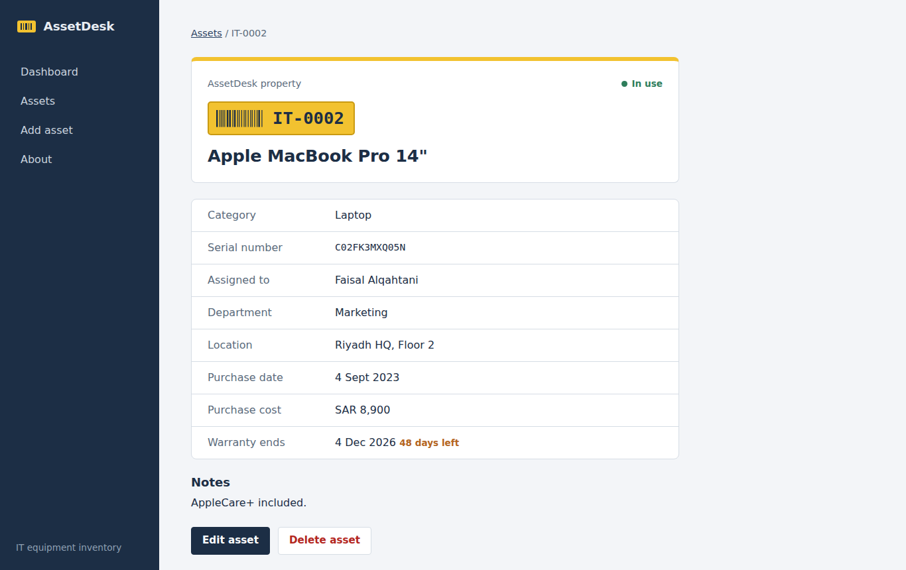
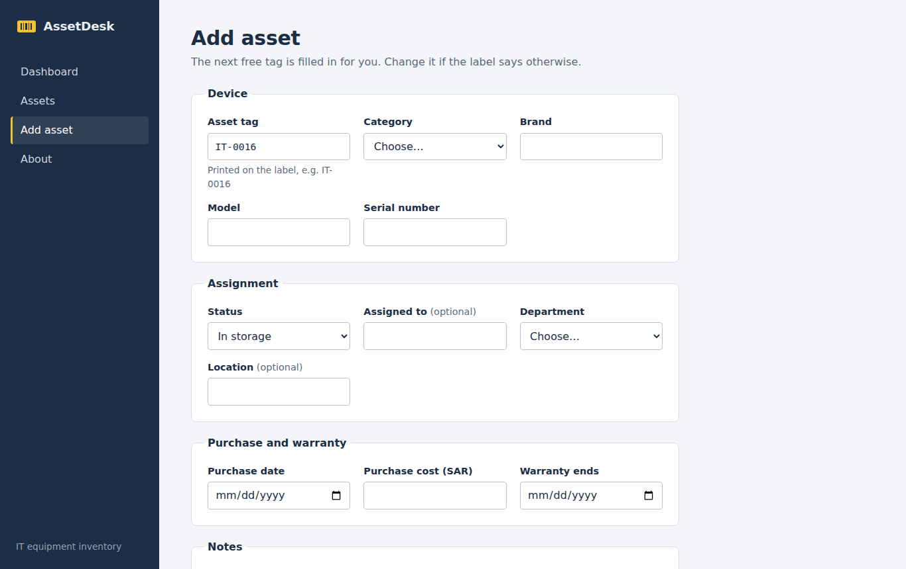
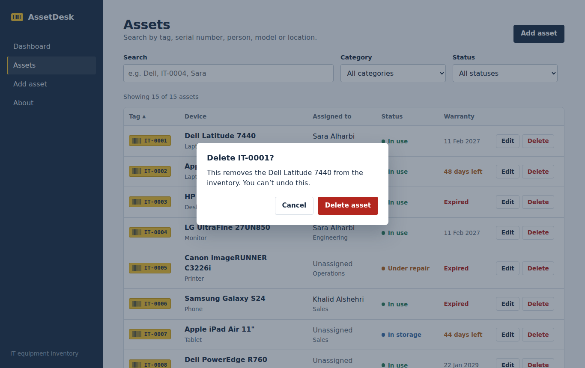

# Visual design

## Design idea

The most recognisable object in IT asset management is the **asset label**: the yellow sticker with a barcode and tag number attached to every company device. AssetDesk uses that label as its one bold visual element. Tags appear as small yellow labels in every list and as a large label on each asset's page. Everything else stays calm and neutral so that the data is easy to read.

## Colour tokens

| Token | Hex | Use |
|---|---|---|
| Ink | `#1C2E45` | Sidebar, headings, primary buttons |
| Paper | `#F3F5F8` | Page background |
| Steel | `#5B6B7C` | Secondary text, labels |
| Line | `#D6DDE5` | Borders and dividers |
| Label yellow | `#F2C230` | Asset tags, active menu marker, brand mark |
| Status colours | `#2E7D5B` in use · `#3B6EA8` in storage · `#B4651E` under repair · `#7A8794` retired | Status dots and bars |
| Danger | `#B3261E` | Delete actions, errors, expired warranties |

Status is always shown as **text plus colour**, never colour alone.

## Typography

- **Public Sans** for all interface text. It is a clear, neutral sans-serif designed for public-service interfaces.
- **JetBrains Mono** only for codes that people read character by character: asset tags and serial numbers.
- Both fonts fall back to system fonts if they cannot load.
- Type scale: page title 30 px, section title 18 px, body 16 px, secondary text 14 px.

## Layout

```
+-----------+---------------------------------------------+
| AssetDesk |  Page title                    [Add asset]  |
|           |  Short description                          |
| Dashboard |                                             |
| Assets    |  [Search............] [Category] [Status]   |
| Add asset |                                             |
| About     |  +---------------------------------------+  |
|           |  | Tag | Device | Assigned | Status | ...|  |
|           |  +---------------------------------------+  |
+-----------+---------------------------------------------+
```

- A fixed left sidebar holds the menu. On screens narrower than about 830 px it becomes a top bar with a **Menu** button.
- Content is left-aligned with a maximum width so lines stay readable.
- The table scrolls sideways inside its own box on small screens, so the page itself never scrolls sideways.

## Screens

| Screen | Purpose |
|---|---|
| Dashboard | What needs attention first, then breakdowns by status and category |
| Assets | Search, filter, sort; edit or delete from each row |
| Asset details | Large asset label, all fields, edit and delete |
| Add / Edit asset | One form in four groups: Device, Assignment, Purchase and warranty, Notes |
| About | Team members and student IDs, and a short description of how the app is built |

Screenshots are in [`docs/screenshots`](screenshots).

| | |
|---|---|
|  |  |
|  |  |

## Interaction and writing

- Buttons say exactly what they do: "Add asset", "Save changes", "Delete asset".
- Confirmation messages use the same words as the button: "Added IT-0016", "Deleted IT-0005".
- Errors explain how to fix the problem, for example "Use the format IT-0001." or "Warranty cannot end before the purchase date."
- Empty states offer the next step ("Clear filters", "Add the first asset").
- Motion is limited to the confirmation message sliding in, and it is turned off when the user prefers reduced motion.

## Accessibility checklist

- Every input has a visible label. Errors are linked with `aria-describedby`, and invalid fields get `aria-invalid`.
- On a failed save, focus moves to the first invalid field and a summary is announced.
- The delete dialog is an `alertdialog`: focus moves to Cancel, Escape closes it, and focus returns afterwards.
- Sortable column headers are buttons and report their state with `aria-sort`.
- A "Skip to content" link, visible focus outlines, and a live region that announces result counts and messages.
