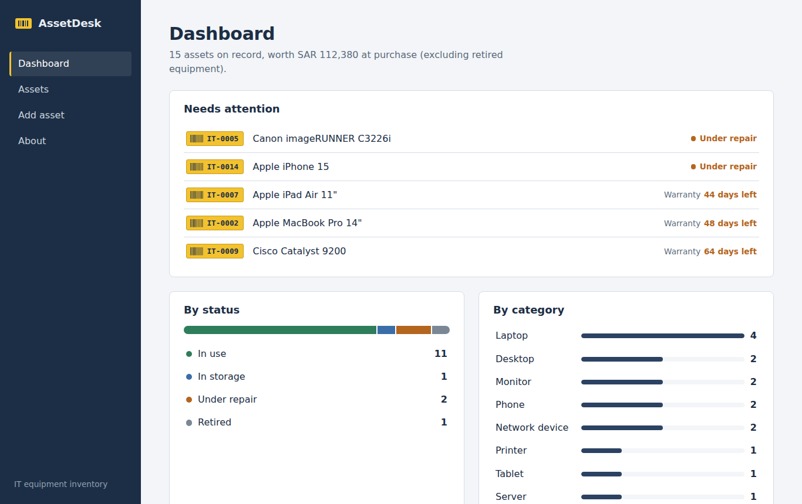
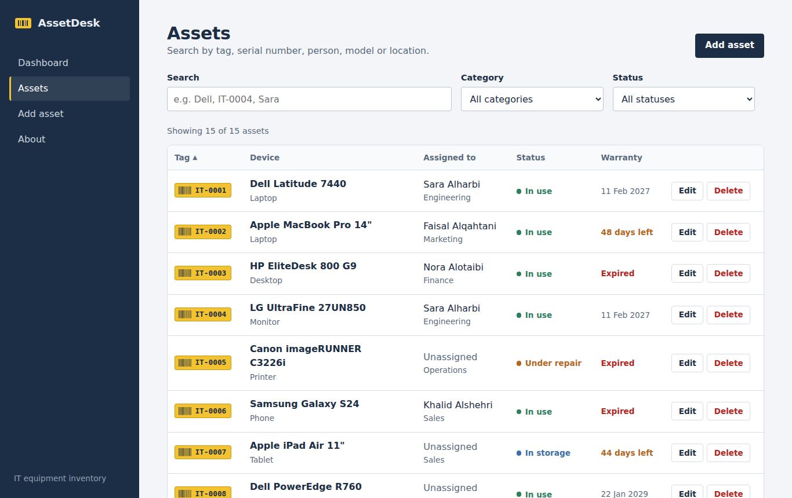
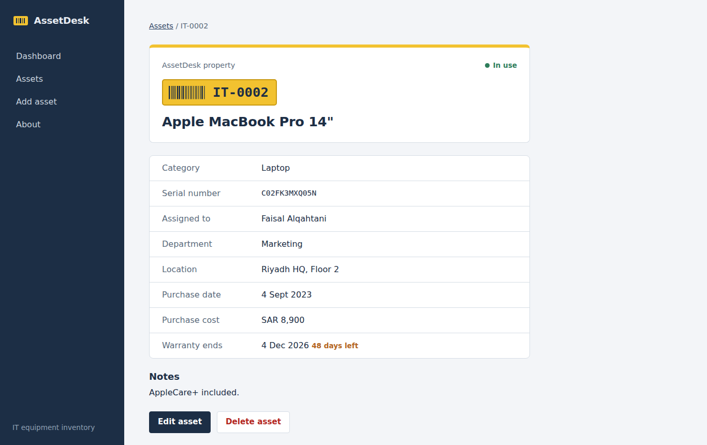
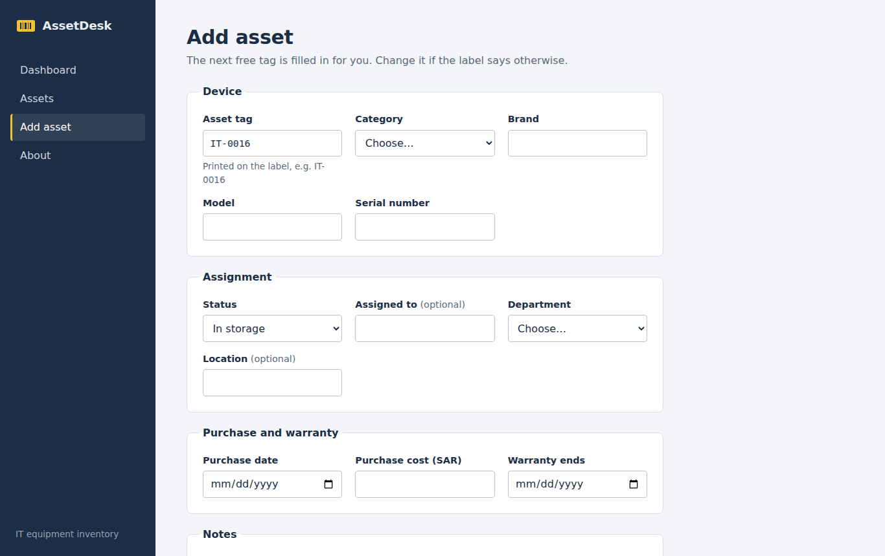
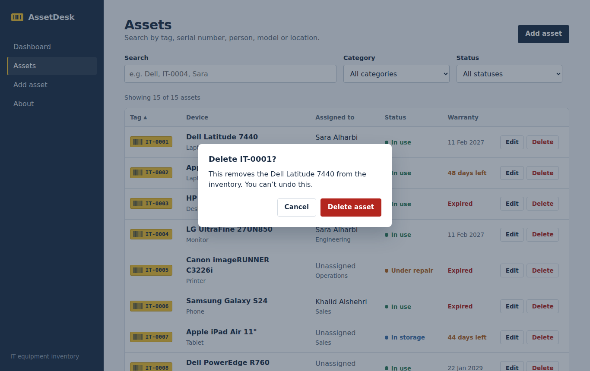
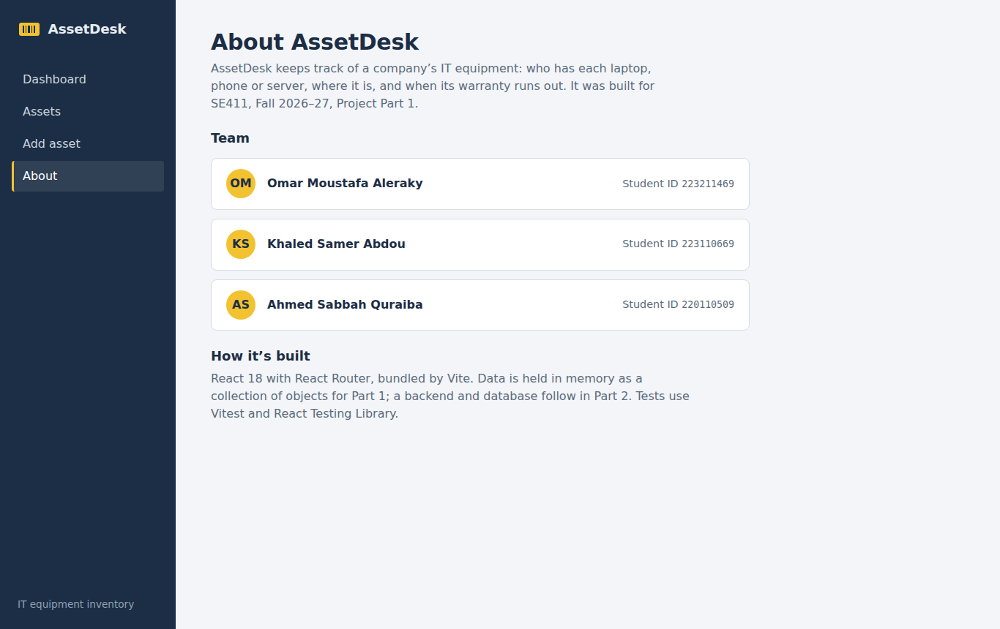
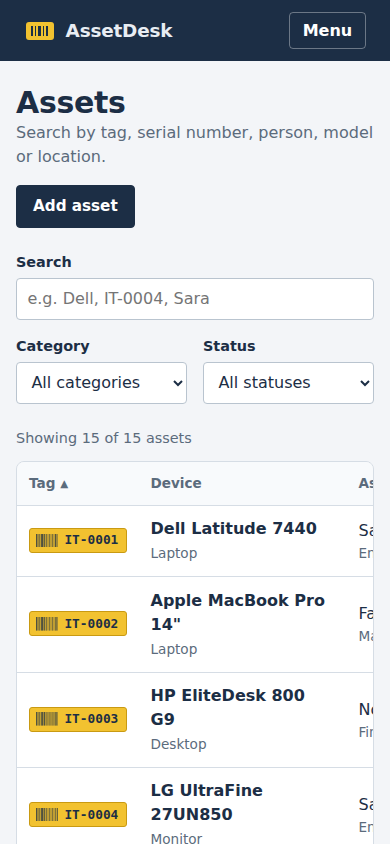

# Features

AssetDesk manages one kind of company asset: **IT equipment**. All data is kept in memory for Part 1 and resets to 15 sample assets when the page is reloaded.

## Menu

The sidebar menu links to **Dashboard**, **Assets**, **Add asset** and **About**. The current page is highlighted with a yellow marker. On phones the menu collapses behind a **Menu** button.

## Dashboard (`/`)

- **Inventory summary:** a one-line summary of how many assets there are and their total purchase value. Retired equipment is excluded from the value.
- **Needs attention:**
  - Assets that are under repair.
  - Assets whose warranty ends within 90 days, soonest first.
  - Each item links to that asset's page.
- **By status:**
  - A bar showing the share of each status, with a count for each status.
  - Clicking a status opens the asset list filtered to that status.
- **By category:**
  - Counts per category with relative bars.
  - Clicking a category opens the filtered list.

## Display and search assets (`/assets`)

- **Table:** shows every asset's tag label, device and category, assigned person and department, status, and warranty.
- **Warranty column:**
  - Shows the end date while the warranty is valid.
  - Shows "N days left" when it ends within 90 days.
  - Shows "Expired" once it has passed.
- **Search box:** matches tag, brand, model, serial number, person, department, location and category. Multi-word searches such as `apple laptop` must match every word. Results update as you type.
- **Category and status filters:** combine with the search.
- **Result count:** "Showing X of Y assets".
- **Clear filters** resets the search and both filters.
- **Sorting:** click a column header to sort, and click again to reverse the order.
- **Shareable filters:** filters are kept in the address, so a filtered list can be bookmarked and the Back button works.
- **Row actions:** each row has **Edit** and **Delete**. Clicking the device name opens its details.

## Asset details (`/assets/:id`)

- **Asset label:** a large label shows the tag, device name and status.
- **All fields:**
  - Category
  - Serial number
  - Assigned to
  - Department
  - Location
  - Purchase date
  - Cost
  - Warranty end date, with the warranty state
  - Notes
- **Actions:** **Edit asset** and **Delete asset** buttons.

## Add an asset (`/assets/new`)

- **Form groups:** the form has four groups: Device, Assignment, Purchase and warranty, and Notes.
- **Suggested tag:** the asset tag is pre-filled with the next free number (for example `IT-0016`).
- **Validation on save:**
  - Required fields must be filled in.
  - Tags must use the `IT-0000` format.
  - Tags and serial numbers must be unique.
  - Dates must be real dates.
  - The warranty cannot end before the purchase date.
  - The cost must be 0 or more.
  - Text must stay within length limits.
- **Assignment rule:** an asset that is "In use" must have a person assigned.
- **Error handling:** errors appear under each field, a summary appears at the top, and focus moves to the first problem. Errors clear as soon as they are fixed.
- **After saving:** the app opens the new asset's page and shows "Added IT-0016".

## Update an asset (`/assets/:id/edit`)

- **Pre-filled form:** the same form opens with the asset's current values.
- **Same rules as adding:** an asset may keep its own tag and serial number.
- **Save changes** returns to the details page with "Saved changes to IT-0007".
- **Cancel** returns without changing anything.

## Delete an asset

- **Where:** available from the list (row **Delete**) and the details page (**Delete asset**).
- **Confirmation:** a dialog asks for confirmation and names the tag and device. **Cancel**, the Escape key, or clicking outside the dialog keeps the asset.
- **After deleting:**
  - A "Deleted IT-0005" message appears.
  - From the details page, the app returns to the asset list.

## About (`/about`)

- **Team:** lists the three team members with their student IDs.
- **About the app:** a short description of what the app does and how it is built.

## Other behaviour

- **Unknown addresses:** these show a "Page not found" screen with a link to the dashboard.
- **Missing assets:** links to an asset that was deleted show "Asset not found" with a link back to the list.
- **Small screens:** the layout adapts to phones, and the table scrolls sideways inside its own box.

